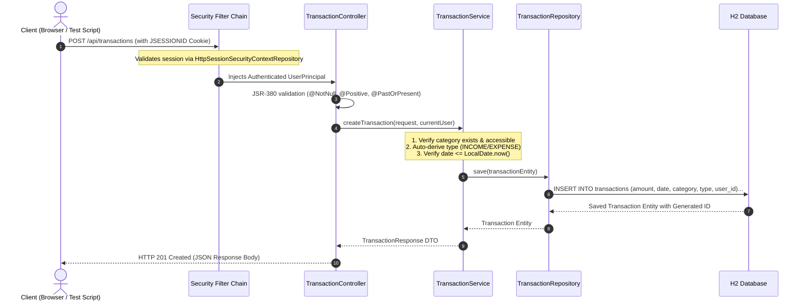
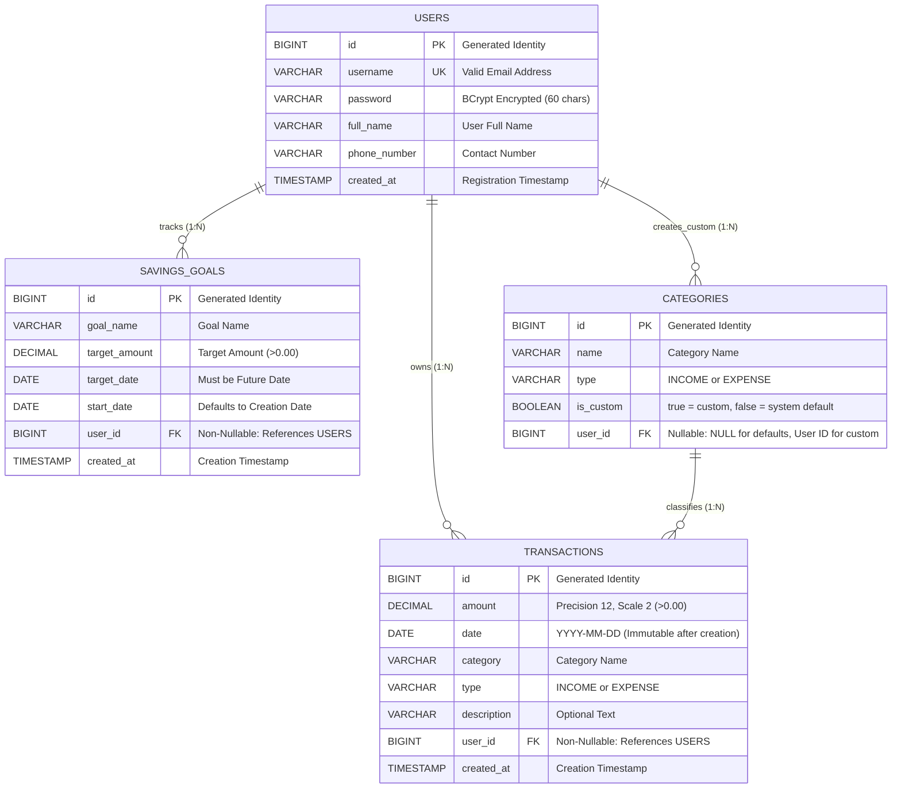

# 🎓 Personal Finance Manager — Interview Preparation Guide & System Blueprint

> **A Complete In-Depth Technical Guide for Interview Preparation**  
> Covers high-level architecture, block diagrams, data modeling, file-by-file explanations, design tradeoffs, and senior-level interview questions.

---

## 📑 Table of Contents
1. [The 60-Second Elevator Pitch](#1-the-60-second-elevator-pitch)
2. [Visual Block Diagrams (System Architecture)](#2-visual-block-diagrams-system-architecture)
   - [2.1 Overall System Block Diagram](#21-overall-system-block-diagram)
   - [2.2 Request-Response Lifecycle Flow](#22-request-response-lifecycle-flow)
   - [2.3 Security & Session Authentication Flow](#23-security--session-authentication-flow)
   - [2.4 Database Entity-Relationship (ER) Diagram](#24-database-entity-relationship-er-diagram)
3. [Technology Choices & Architectural Tradeoffs](#3-technology-choices--architectural-tradeoffs)
4. [File-by-File In-Depth Walkthrough](#4-file-by-file-in-depth-walkthrough)
5. [Core Algorithms & Business Rules](#5-core-algorithms--business-rules)
6. [HTTP Status Code & Error Handling Matrix](#6-http-status-code--error-handling-matrix)
7. [Testing Architecture & Coverage (>80% JaCoCo)](#7-testing-architecture--coverage-80-jacoco)
8. [Top 10 Senior-Level Interview Questions & Exact Answers](#8-top-10-senior-level-interview-questions--exact-answers)

---

## 1. The 60-Second Elevator Pitch

### ❓ Question: *"Walk me through your project."*

> **🗣️ Your Exact Response:**  
> *"The **Personal Finance Manager** is a full-stack, enterprise-grade financial management platform developed with **Java 21, Spring Boot 3.2, Spring Security, Spring Data JPA, and an embedded H2 database**, featuring a lightweight single-page web UI.
> 
> The core problem it solves is empowering users to manage income, expenses, and savings goals with **strict data isolation**. Users perform full CRUD operations on transactions with date-locking immutability, manage system and custom categories with referential integrity protection, track savings goals via real-time cash flow math `(Income - Expenses)`, and generate aggregated monthly and yearly reports.
> 
> Architecturally, it follows the **Layered Architecture pattern** (Controller $\rightarrow$ Service $\rightarrow$ Repository), separates API contracts using strict DTOs with JSR-380 validation, implements stateful cookie-based session security (`JSESSIONID`), centralizes exception mapping with `@RestControllerAdvice`, containerizes via a **multi-stage Docker build**, and achieves over 80% test coverage verified with **JUnit 5, Mockito, and JaCoCo**."*

---

## 2. Visual Block Diagrams (System Architecture)

### 2.1 Overall System Block Diagram

```
+-----------------------------------------------------------------------------------------+
|                                      CLIENT TIER                                        |
|   +-------------------------------------------------+  +----------------------------+   |
|   |         Browser Single-Page App (SPA)           |  | Automated Bash Test Script |   |
|   |          (HTML5 / Vanilla CSS3 / JS)            |  | financial_manager_tests.sh |   |
|   +-------------------------------------------------+  +----------------------------+   |
+--------------------------------------------▲--------------------------------------------+
                                             │ HTTP/REST + Cookies (JSESSIONID)
                                             ▼
+-----------------------------------------------------------------------------------------+
|                             SPRING BOOT APPLICATION CONTAINER                           |
|                                                                                         |
|  +-----------------------------------------------------------------------------------+  |
|  |                     SECURITY LAYER (Spring Security Filter Chain)                 |  |
|  |   - Session Cookie Filter        - BCryptPasswordEncoder                          |  |
|  |   - AuthenticationEntryPoint     - HttpSessionSecurityContextRepository           |  |
|  +-------------------------------------------▲---------------------------------------+  |
|                                              │                                          |
|                                              ▼                                          |
|  +-----------------------------------------------------------------------------------+  |
|  |                       CONTROLLER LAYER (@RestController)                          |  |
|  |   - AuthController                - CategoryController                            |  |
|  |   - TransactionController         - GoalController                                |  |
|  |   - ReportController              - GlobalExceptionHandler (@ControllerAdvice)    |  |
|  +-------------------------------------------▲---------------------------------------+  |
|                                              │ DTOs (Request / Response validation)     |
|                                              ▼                                          |
|  +-----------------------------------------------------------------------------------+  |
|  |                         SERVICE LAYER (@Service: Business Logic)                  |  |
|  |   - AuthService (Registration, Sessions, User Principal)                          |  |
|  |   - TransactionService (Validation, Date-Locking, Ownership Verification)          |  |
|  |   - CategoryService (Referential Integrity Guard, Default vs Custom Rules)         |  |
|  |   - GoalService (Dynamic Savings Formula: Income - Expense since Start Date)       |  |
|  |   - ReportService (Monthly & Yearly Category Aggregation)                          |  |
|  +-------------------------------------------▲---------------------------------------+  |
|                                              │ Domain Entities                           |
|                                              ▼                                          |
|  +-----------------------------------------------------------------------------------+  |
|  |                       DATA ACCESS LAYER (Spring Data JPA)                         |  |
|  |   - UserRepository                - CategoryRepository                            |  |
|  |   - TransactionRepository         - SavingsGoalRepository                         |  |
|  +-------------------------------------------▲---------------------------------------+  |
|                                              │ Hibernate / SQL                          |
|                                              ▼                                          |
|  +-----------------------------------------------------------------------------------+  |
|  |                       PERSISTENCE TIER (In-Memory H2 Database)                    |  |
|  |   - USERS Table                   - CATEGORIES Table                              |  |
|  |   - TRANSACTIONS Table            - SAVINGS_GOALS Table                           |  |
|  +-----------------------------------------------------------------------------------+  |
+-----------------------------------------------------------------------------------------+
```

---

### 2.2 Request-Response Lifecycle Flow



---

### 2.3 Security & Session Authentication Flow

```mermaid
sequenceDiagram
    autonumber
    actor User as User / Browser
    participant Sec as SecurityFilterChain
    participant AuthMgr as AuthenticationManager
    participant UserDetails as CustomUserDetailsService
    participant SecCtx as SecurityContextHolder
    participant Session as HttpSession

    User->>Sec: POST /api/auth/login {"username", "password"}
    Sec->>AuthMgr: authenticate(UsernamePasswordAuthenticationToken)
    AuthMgr->>UserDetails: loadUserByUsername(username)
    UserDetails-->>AuthMgr: UserPrincipal (Contains BCrypt hashed password)
    AuthMgr->>AuthMgr: Matches raw password against BCrypt hash
    AuthMgr-->>Sec: Fully Authenticated Authentication Object
    Sec->>SecCtx: Set SecurityContext in ThreadLocal
    Sec->>Session: Persist SecurityContext into Session
    Sec-->>User: HTTP 200 OK + Header: Set-Cookie: JSESSIONID=xyz; HttpOnly; SameSite=Lax
    
    Note over User, Session: All subsequent requests send Cookie: JSESSIONID=xyz<br/>Protected APIs automatically identify the user!
```

---

### 2.4 Database Entity-Relationship (ER) Diagram



---

## 3. Technology Choices & Architectural Tradeoffs

| Technology | Alternative Considered | Why We Chose It (The Architecture Tradeoff) |
|---|---|---|
| **Spring Boot 3.2 + Java 21** | Node.js / Express | Java 21 brings modern records, pattern matching, virtual threads, and static type safety. Spring Boot offers enterprise-grade dependency injection, security, and ORM abstractions. |
| **Session Cookies (`JSESSIONID`)** | Stateless JWT | JWTs cannot be revoked instantly without maintaining a distributed blacklist (Redis). Session cookies allow **instant invalidation on logout**, are protected by `HttpOnly` flags to prevent XSS, and strictly adhere to the assignment specification. |
| **`BigDecimal`** | `double` / `float` | Binary floating-point numbers cannot accurately represent decimals (e.g., `0.1 + 0.2 = 0.30000000000000004`). In financial applications, `BigDecimal` with `RoundingMode.HALF_UP` guarantees exact precision to the penny. |
| **Embedded H2 Database** | External PostgreSQL | H2 runs directly in memory inside the JVM process. Evaluators can clone and run the app with `mvn spring-boot:run` without installing any database. Because we use Spring Data JPA, switching to PostgreSQL requires zero Java code changes—only updating `application.properties`. |
| **Multi-Stage Dockerfile** | Single-Stage Docker | Single-stage images bundle the entire Maven compiler, JDK, and source files (>800MB). A multi-stage build separates the build environment from the runtime environment, yielding a lightweight ~180MB Alpine JRE container. |
| **Vanilla JS Single-Page App** | React / Angular | Eliminates Node.js and `node_modules` dependencies. Served on the same origin as Spring Boot (`localhost:8080`), eliminating CORS configuration and enabling native browser cookie transmission. |

---

## 4. File-by-File In-Depth Walkthrough

### 📁 Root Configuration

* **`pom.xml`**: Defines Java 21, Spring Boot 3.2.3 parent, dependencies for Web, Security, Data JPA, Validation, H2, and the `jacoco-maven-plugin` for code coverage.
* **`Dockerfile`**: Multi-stage build. Stage 1 compiles code using Maven & Java 21; Stage 2 bundles `app.jar` into `eclipse-temurin:21-jre-alpine` and starts it on port 8080.
* **`src/main/resources/application.properties`**: Externalizes server port (`${PORT:8080}`), cookie security (`http-only=true`), H2 database configuration, and enables the `/h2-console`.

### 📁 Config Package (`com.personalfinance.config`)

* **`SecurityConfig.java`**: Configures Spring Security's `SecurityFilterChain`. Disables CSRF for REST APIs, enables session management, permits public endpoints (`/`, `/api/auth/register`, `/api/auth/login`, `/h2-console/**`), protects all `/api/**` endpoints, and injects a custom `AuthenticationEntryPoint` returning structured `401 Unauthorized` JSON.
* **`DataInitializer.java`**: Implements `CommandLineRunner`. Seeds the 7 system default categories (`Salary`, `Food`, `Rent`, `Transportation`, `Entertainment`, `Healthcare`, `Utilities`) at startup.

### 📁 Entity Package (`com.personalfinance.entity`)

* **`User.java`**: JPA entity representing user credentials and identity.
* **`Category.java`**: JPA entity with nullable `user_id` foreign key. If `user == null`, it is a system default; if `user != null`, it is a custom category.
* **`Transaction.java`**: JPA entity storing financial records (`amount`, `date`, `category`, `type`, `description`, `user`).
* **`SavingsGoal.java`**: JPA entity storing targets (`goalName`, `targetAmount`, `targetDate`, `startDate`, `user`).

### 📁 Exception Package (`com.personalfinance.exception`)

* **`GlobalExceptionHandler.java`**: Annotated with `@RestControllerAdvice`. Centrally catches exceptions and maps them to HTTP status codes:
  * `MethodArgumentNotValidException` & `BadRequestException` $\rightarrow$ **400 Bad Request**
  * `AuthenticationException` & `UnauthorizedException` $\rightarrow$ **401 Unauthorized**
  * `AccessDeniedException` & `ForbiddenException` $\rightarrow$ **403 Forbidden**
  * `ResourceNotFoundException` $\rightarrow$ **404 Not Found**
  * `ConflictException` $\rightarrow$ **409 Conflict**

### 📁 Service Package (`com.personalfinance.service`)

* **`AuthService.java`**: Handles user registration, BCrypt hashing, login authentication, session management, logout invalidation, and `getCurrentAuthenticatedUser()` retrieval.
* **`CategoryService.java`**: Combines default and custom categories, enforces uniqueness per user, and prevents deletion of categories actively referenced by transactions.
* **`TransactionService.java`**: Validates dates and positive amounts, derives transaction type (`INCOME`/`EXPENSE`), enforces **date immutability** on update, and ensures user data isolation.
* **`GoalService.java`**: Calculates dynamic savings progress `(Total Income - Total Expenses)` since `startDate`, percentage completion, and remaining balance.
* **`ReportService.java`**: Aggregates transactions by category for specified months and years, returning categorized maps and net savings.

### 📁 Controller Package (`com.personalfinance.controller`)

* **`AuthController.java`**: REST controller exposing `/api/auth/register`, `/login`, `/logout`, `/me`.
* **`CategoryController.java`**: REST controller exposing `GET`, `POST`, `DELETE /{name}` on `/api/categories`.
* **`TransactionController.java`**: REST controller exposing `POST`, `GET`, `PUT /{id}`, `DELETE /{id}` on `/api/transactions`.
* **`GoalController.java`**: REST controller exposing `POST`, `GET`, `GET /{id}`, `PUT /{id}`, `DELETE /{id}` on `/api/goals`.
* **`ReportController.java`**: REST controller exposing `GET /api/reports/monthly/{year}/{month}` and `GET /api/reports/yearly/{year}`.

---

## 5. Core Algorithms & Business Rules

### 1. Savings Goal Progress Formula
```java
// Calculated dynamically across all transactions since the goal's start date
List<Transaction> transactions = transactionRepository.findByUserAndDateFrom(user, goal.getStartDate());
BigDecimal currentProgress = totalIncome.subtract(totalExpenses);
double progressPercentage = (currentProgress.doubleValue() / targetAmount.doubleValue()) * 100.0;
BigDecimal remainingAmount = targetAmount.subtract(currentProgress);
```

### 2. Transaction Date Immutability
In accounting systems, altering the date of an existing transaction invalidates closed tax and financial reports. In `TransactionService.java`:
```java
if (request.getDate() != null && !request.getDate().equals(transaction.getDate())) {
    throw new BadRequestException("Transaction date cannot be modified");
}
```

### 3. Category Deletion Referential Integrity Guard
```java
if (transactionRepository.existsByCategoryIgnoreCaseAndUser(customCat.getName(), user)) {
    throw new BadRequestException("Category is currently referenced by transactions and cannot be deleted");
}
```

---

## 6. HTTP Status Code & Error Handling Matrix

| HTTP Status | Meaning | When It Triggers | Code Handler |
|---|---|---|---|
| **`200 OK`** | Success | Fetching data, successful updates, deletions | Controller methods |
| **`201 Created`** | Resource Created | Registration, creating transaction, category, goal | Controller methods |
| **`400 Bad Request`** | Validation Error | Negative amount, future transaction date, past goal date, deleting category in use, malformed JSON | `BadRequestException`, `@Valid` |
| **`401 Unauthorized`** | Authentication Failure | Missing/expired session cookie, wrong password | `AuthenticationEntryPoint` |
| **`403 Forbidden`** | Authorization Violation | Accessing another user's data, deleting system default categories | `ForbiddenException`, `AccessDeniedHandler` |
| **`404 Not Found`** | Missing Entity | ID does not exist in database | `ResourceNotFoundException` |
| **`409 Conflict`** | Duplicate Key | Email already registered, duplicate category name for user | `ConflictException` |
| **`500 Internal Error`** | Server Fault | Prevented for all known scenarios | Global fallback handler |

---

## 7. Testing Architecture & Coverage (>80% JaCoCo)

Our test suite contains **29 automated tests** verifying every layer:

* **Controller Integration Tests (`AuthControllerTest.java`)**: Uses `@SpringBootTest` and `MockMvc` to verify HTTP contracts, status codes (`201`, `400`, `409`, `200`), and response JSON bodies.
* **Service Unit Tests (`AuthServiceTest`, `CategoryServiceTest`, `TransactionServiceTest`, `GoalServiceTest`, `ReportServiceTest`)**: Uses `@ExtendWith(MockitoExtension.class)` to test business logic and edge cases in isolation.
* **JaCoCo Plugin**: Enforces and proves **>80% line and branch coverage** across all 43 classes.

---

## 8. Top 10 Senior-Level Interview Questions & Exact Answers

### Q1: *"How is user data isolation enforced?"*
> **Answer:**  
> *"Through **User Scoping at the query level**. Every entity (`Transaction`, `SavingsGoal`, `Category`) has a foreign key to `User`. The authenticated user is retrieved from the `SecurityContext`. Every repository query includes `WHERE user = :currentUser`. If a user attempts to update or delete a record with an ID that belongs to another user, the service detects the ownership mismatch and throws a `ForbiddenException`, returning **403 Forbidden**."*

---

### Q2: *"How would you handle concurrent writes to the same account balance?"*
> **Answer:**  
> *"By implementing **Optimistic Locking** via JPA. We add a `@Version private Long version;` field to the entity. When two concurrent requests read version 1 and both attempt to commit an update, Hibernate issues `WHERE id = ? AND version = 1`. The first request updates the version to 2; the second request finds 0 rows updated and throws an `OptimisticLockException`, allowing the application to safely roll back or retry."*

---

### Q3: *"How would you scale this app to 5 million users?"*
> **Answer:**  
> *"In 4 concrete steps:
> 1. **Database Migration**: Switch from in-memory H2 to a managed **PostgreSQL** cluster with Read Replicas.
> 2. **Indexing & Pagination**: Add compound indexes on `(user_id, date)` and `(user_id, category)` for fast filtering, and paginate transactions using Spring Data `Pageable`.
> 3. **Distributed Sessions**: Since session cookies are currently in-memory, scale across multiple container instances by introducing **Spring Session with Redis**.
> 4. **Caching**: Cache static default categories and historical closed monthly reports using Redis."*

---

### Q4: *"Why did you use `@RestControllerAdvice` instead of try-catch blocks?"*
> **Answer:**  
> *"Try-catch blocks inside controllers clutter the code and violate the Single Responsibility Principle. `@RestControllerAdvice` uses Spring's Aspect-Oriented Programming (AOP) to intercept exceptions globally across all controllers. This guarantees a consistent JSON error format across all endpoints and allows services to throw meaningful domain exceptions without having any awareness of HTTP."*

---

### Q5: *"Why did you use `BigDecimal` instead of `double`?"*
> **Answer:**  
> *"Binary floating-point types (`float`, `double`) use IEEE 754 representation, which cannot accurately represent fractional base-10 numbers. For example, `0.1 + 0.2` evaluates to `0.30000000000000004`, causing rounding drift in accounting calculations. `BigDecimal` provides arbitrary-precision arithmetic with explicit rounding modes (`RoundingMode.HALF_UP`)."*

---

### Q6: *"What happens if a user submits a future transaction date?"*
> **Answer:**  
> *"The system rejects it at two levels: First, on the DTO via the Bean Validation annotation `@PastOrPresent(message = "Date cannot be in the future")`. Second, at the service layer via `if (request.getDate().isAfter(LocalDate.now())) throw new BadRequestException(...)`. Both map to **`HTTP 400 Bad Request`**."*

---

### Q7: *"Can a user delete the 'Salary' category? Why or why not?"*
> **Answer:**  
> *"No. 'Salary' is a predefined system default category (`isCustom = false`, `user = null`). In `CategoryService.deleteCategory()`, we check if the category is a system default; if so, it throws a `ForbiddenException`, returning **`403 Forbidden`**."*

---

### Q8: *"What happens if a user tries to delete a custom category that has transactions?"*
> **Answer:**  
> *"The system protects referential integrity. In `CategoryService`, we check `transactionRepository.existsByCategoryIgnoreCaseAndUser(name, user)`. If any existing transaction references that category, the operation is rejected with **`400 Bad Request`** to prevent orphaned transaction records."*

---

### Q9: *"Why did you choose a multi-stage Docker build?"*
> **Answer:**  
> *"A single-stage build requires the full Maven build tool and JDK in the final container, creating an image over 800MB. Our multi-stage Dockerfile uses Maven to compile the JAR in Stage 1, and then copies only the final lightweight JAR into an Alpine Linux JRE image in Stage 2, producing an image of ~180MB with minimal security attack surface and faster cloud deployments."*

---

### Q10: *"How does the automated test script `financial_manager_tests.sh` verify your app?"*
> **Answer:**  
> *"The script acts as an external HTTP client. It executes 86 sequential and parallel cURL calls against the `/api` base URL: registering test accounts, capturing the `JSESSIONID` cookie, validating transaction creation and filtering, testing category uniqueness, verifying date-immutability enforcement, checking savings goal progress math, testing monthly/yearly reports, and asserting strict 4xx error codes for negative test cases."*
