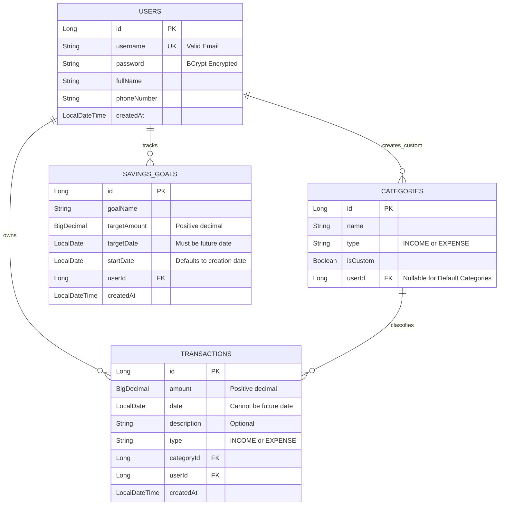

# Personal Finance Manager

A comprehensive, production-grade **Personal Finance Management System** built with **Java 17**, **Spring Boot 3.x**, and **Spring Security**, featuring session-based cookie authentication, full CRUD operations on financial transactions, custom category management, savings goals with real-time progress tracking, financial reporting & analytics, and an integrated, lightweight web UI.

---

## 📑 Table of Contents
1. [Overview & Features](#overview--features)
2. [Architecture & Design Decisions](#architecture--design-decisions)
3. [Technology Stack](#technology-stack)
4. [Database Schema & Data Model](#database-schema--data-model)
5. [Complete API Specification](#complete-api-specification)
   - [1. User Management & Authentication](#1-user-management--authentication)
   - [2. Transaction Management](#2-transaction-management)
   - [3. Category Management](#3-category-management)
   - [4. Savings Goals](#4-savings-goals)
   - [5. Reports & Analytics](#5-reports--analytics)
6. [Input Validation & Error Handling (HTTP Status Codes)](#input-validation--error-handling)
7. [Basic Frontend UI Guide](#basic-frontend-ui-guide)
8. [Local Setup & Running Instructions](#local-setup--running-instructions)
9. [Running Automated Tests](#running-automated-tests)
10. [Deployment Guide (Render.com)](#deployment-guide-rendercom)
11. [Verification with `financial_manager_tests.sh`](#verification-with-financial_manager_testssh)

---

## 💡 Overview & Features

The Personal Finance Manager enables individual users to manage their personal income and expenditures with complete data isolation:
* **Session-Based Authentication:** Secure, cookie-based session management (`JSESSIONID`) with BCrypt password hashing.
* **Transaction Management:** Full CRUD operations on income and expense entries with sorting (newest first) and multi-parameter filtering (date range, category). Transactions lock the date upon creation to maintain historical integrity.
* **Predefined & Custom Categories:** Seeded system categories (`Salary`, `Food`, `Rent`, `Utilities`, etc.) combined with user-defined custom categories. Deletion safeguards prevent removing categories actively in use.
* **Independent Savings Goals:** Track specific financial milestones with automated progress computation `(Total Income - Total Expenses) since Goal Start Date`, percentage completion, and remaining amounts.
* **Monthly & Yearly Financial Reports:** Detailed aggregate summaries of income and expenses categorized systematically with net savings calculations.
* **Built-in Lightweight UI:** A clean, zero-dependency browser interface served directly from the Spring Boot static resources, allowing interactive operation and testing out of the box.

---

## 🏗️ Architecture & Design Decisions

The application follows the enterprise standard **Layered Architecture**:

```
+-----------------------------------------------------------------------------------+
|                        Web Browser / Client Applications                          |
|             (Embedded Single-Page UI / financial_manager_tests.sh)               |
+-----------------------------------------------------------------------------------+
                                         │  HTTP / JSON + Cookie (JSESSIONID)
                                         ▼
+-----------------------------------------------------------------------------------+
|                       Security & Filter Chain (Spring Security)                   |
|          Session Authentication, Authorization, CSRF disabled for REST APIs       |
+-----------------------------------------------------------------------------------+
                                         │
                                         ▼
+-----------------------------------------------------------------------------------+
|                       Controller Layer (@RestController)                         |
|   AuthController | TransactionController | CategoryController | GoalController    |
|   ReportController | GlobalExceptionHandler (@ControllerAdvice)                  |
+-----------------------------------------------------------------------------------+
                                         │  DTOs (Request / Response validation)
                                         ▼
+-----------------------------------------------------------------------------------+
|                         Service Layer (@Service)                                  |
|   Business Logic, Isolation Checks, Savings Math, Financial Aggregations          |
+-----------------------------------------------------------------------------------+
                                         │
                                         ▼
+-----------------------------------------------------------------------------------+
|                       Repository Layer (Spring Data JPA)                         |
|   UserRepository | TransactionRepository | CategoryRepository | GoalRepository    |
+-----------------------------------------------------------------------------------+
                                         │
                                         ▼
+-----------------------------------------------------------------------------------+
|                       Database Layer (H2 In-Memory / File)                       |
+-----------------------------------------------------------------------------------+
```

### Key Design Decisions:
1. **Data Isolation:** Every business entity (Transactions, Custom Categories, Goals) is linked to a specific `User`. All database queries enforce filtering by the currently authenticated user (`findByUserId`), preventing cross-user data leakage (HTTP 403 Forbidden).
2. **DTO Separation:** Domain entities are never exposed directly to clients. Dedicated Request and Response DTOs with `@Valid`, `@NotBlank`, `@Email`, `@Positive`, and custom validation ensure strong contract guarantees.
3. **Immutability of Transaction Dates:** Per requirements, `PUT /api/transactions/{id}` ignores or prohibits changes to the `date` field, ensuring historical consistency for savings goal and reporting aggregations.
4. **Referential Integrity for Categories:** A custom category cannot be deleted if transactions reference it; doing so returns an explicit `400 Bad Request` or `409 Conflict`.
5. **Session Management:** Uses Spring Security's native `SecurityContextRepository` and `HttpSessionSecurityContextRepository` to deliver standards-compliant `JSESSIONID` cookies without requiring external token stores.

---

## 🛠️ Technology Stack

| Component | Technology | Version | Description |
|---|---|---|---|
| **Language** | Java | 17+ | Standard enterprise LTS Java |
| **Framework** | Spring Boot | 3.2.x+ | Production application framework |
| **Security** | Spring Security | 6.x | Session-based authentication & authorization |
| **Persistence** | Spring Data JPA / Hibernate | 6.x | ORM & data access abstraction |
| **Database** | H2 Database | 2.x | Lightweight embedded SQL database |
| **Validation** | Hibernate Validator | 8.x | Bean Validation (JSR 380) |
| **Testing** | JUnit 5 & Mockito | 5.x | Unit and integration testing |
| **Build Tool** | Apache Maven | 3.9+ | Build and dependency management |
| **Frontend** | Vanilla HTML5 / CSS3 / JavaScript | - | Lightweight UI in `src/main/resources/static` |

---

## 🗄️ Database Schema & Data Model



### Predefined Default Categories (Auto-Seeded at Startup):
* **INCOME:** `Salary`
* **EXPENSE:** `Food`, `Rent`, `Transportation`, `Entertainment`, `Healthcare`, `Utilities`

---

## 📡 Complete API Specification

All endpoints except `/api/auth/register` and `/api/auth/login` require an active session cookie (`JSESSIONID`).

---

### 1. User Management & Authentication

#### 1.1 Register User
* **URL:** `POST /api/auth/register`
* **Request Body:**
  ```json
  {
    "username": "user@example.com",
    "password": "password123",
    "fullName": "John Doe",
    "phoneNumber": "+1234567890"
  }
  ```
* **Success Response (`201 Created`):**
  ```json
  {
    "message": "User registered successfully",
    "userId": 1
  }
  ```
* **Error Responses:**
  * `400 Bad Request`: Validation failure (invalid email format, empty password, missing fields).
  * `409 Conflict`: Username/email already registered.

#### 1.2 Login User
* **URL:** `POST /api/auth/login`
* **Request Body:**
  ```json
  {
    "username": "user@example.com",
    "password": "password123"
  }
  ```
* **Success Response (`200 OK`):**
  * **Header:** `Set-Cookie: JSESSIONID=...; Path=/; HttpOnly; SameSite=Lax`
  ```json
  {
    "message": "Login successful"
  }
  ```
* **Error Response:**
  * `401 Unauthorized`: Invalid credentials.

#### 1.3 Logout User
* **URL:** `POST /api/auth/logout`
* **Request Body:** *None (Session cookie provided)*
* **Success Response (`200 OK`):**
  ```json
  {
    "message": "Logout successful"
  }
  ```
* **Error Response:**
  * `401 Unauthorized`: Unauthenticated / expired session.

---

### 2. Transaction Management

#### 2.1 Create Transaction
* **URL:** `POST /api/transactions`
* **Request Body:**
  ```json
  {
    "amount": 50000.00,
    "date": "2024-01-15",
    "category": "Salary",
    "description": "January Salary"
  }
  ```
* **Success Response (`201 Created`):**
  ```json
  {
    "id": 1,
    "amount": 50000.00,
    "date": "2024-01-15",
    "category": "Salary",
    "description": "January Salary",
    "type": "INCOME"
  }
  ```
* **Error Responses:**
  * `400 Bad Request`: Amount not positive, date in future, invalid/unknown category.
  * `401 Unauthorized`: Not logged in.

#### 2.2 Get Transactions
* **URL:** `GET /api/transactions`
* **Query Parameters (Optional Filters):**
  * `startDate` (e.g. `2024-01-01`)
  * `endDate` (e.g. `2024-01-31`)
  * `category` (Category name or ID)
  * `type` (`INCOME` or `EXPENSE`)
* **Success Response (`200 OK`):**
  *(Transactions sorted newest first)*
  ```json
  {
    "transactions": [
      {
        "id": 1,
        "amount": 50000.00,
        "date": "2024-01-15",
        "category": "Salary",
        "description": "January Salary",
        "type": "INCOME"
      }
    ]
  }
  ```

#### 2.3 Update Transaction
* **URL:** `PUT /api/transactions/{id}`
* **Constraint:** Any field may be updated **except the date field**.
* **Request Body:**
  ```json
  {
    "amount": 60000.00,
    "description": "Updated January Salary"
  }
  ```
* **Success Response (`200 OK`):**
  ```json
  {
    "id": 1,
    "amount": 60000.00,
    "date": "2024-01-15",
    "category": "Salary",
    "description": "Updated January Salary",
    "type": "INCOME"
  }
  ```
* **Error Responses:**
  * `400 Bad Request`: Invalid amount, attempt to alter date.
  * `401 Unauthorized`: Not authenticated.
  * `403 Forbidden`: Attempting to edit another user's transaction.
  * `404 Not Found`: Transaction with given ID does not exist.

#### 2.4 Delete Transaction
* **URL:** `DELETE /api/transactions/{id}`
* **Success Response (`200 OK`):**
  ```json
  {
    "message": "Transaction deleted successfully"
  }
  ```
* **Error Responses:**
  * `401 Unauthorized`: Not authenticated.
  * `403 Forbidden`: Attempting to delete another user's transaction.
  * `404 Not Found`: Transaction not found.

---

### 3. Category Management

#### 3.1 Get All Categories
* **URL:** `GET /api/categories`
* **Success Response (`200 OK`):**
  ```json
  {
    "categories": [
      { "name": "Salary", "type": "INCOME", "isCustom": false },
      { "name": "Food", "type": "EXPENSE", "isCustom": false },
      { "name": "Rent", "type": "EXPENSE", "isCustom": false },
      { "name": "Transportation", "type": "EXPENSE", "isCustom": false },
      { "name": "Entertainment", "type": "EXPENSE", "isCustom": false },
      { "name": "Healthcare", "type": "EXPENSE", "isCustom": false },
      { "name": "Utilities", "type": "EXPENSE", "isCustom": false },
      { "name": "SideBusinessIncome", "type": "INCOME", "isCustom": true }
    ]
  }
  ```

#### 3.2 Create Custom Category
* **URL:** `POST /api/categories`
* **Request Body:**
  ```json
  {
    "name": "SideBusinessIncome",
    "type": "INCOME"
  }
  ```
* **Success Response (`201 Created`):**
  ```json
  {
    "name": "SideBusinessIncome",
    "type": "INCOME",
    "isCustom": true
  }
  ```
* **Error Responses:**
  * `400 Bad Request`: Invalid category name or invalid type.
  * `409 Conflict`: Category with this name already exists for the user.

#### 3.3 Delete Custom Category
* **URL:** `DELETE /api/categories/{name}`
* **Constraint:** Default categories cannot be deleted. Categories referenced by existing transactions cannot be deleted.
* **Success Response (`200 OK`):**
  ```json
  {
    "message": "Category deleted successfully"
  }
  ```
* **Error Responses:**
  * `400 Bad Request`: Category is currently referenced by transactions.
  * `403 Forbidden`: Attempting to delete a default system category.
  * `404 Not Found`: Category not found.

---

### 4. Savings Goals

#### 4.1 Create Goal
* **URL:** `POST /api/goals`
* **Rules:** `targetAmount` must be positive; `targetDate` must be a future date; `startDate` defaults to creation date if omitted.
* **Request Body:**
  ```json
  {
    "goalName": "Emergency Fund",
    "targetAmount": 5000.00,
    "targetDate": "2026-01-01",
    "startDate": "2025-01-01"
  }
  ```
* **Success Response (`201 Created`):**
  ```json
  {
    "id": 1,
    "goalName": "Emergency Fund",
    "targetAmount": 5000.00,
    "targetDate": "2026-01-01",
    "startDate": "2025-01-01",
    "currentProgress": 1000.00,
    "progressPercentage": 20.0,
    "remainingAmount": 4000.00
  }
  ```

#### 4.2 Get All Goals
* **URL:** `GET /api/goals`
* **Success Response (`200 OK`):**
  ```json
  {
    "goals": [
      {
        "id": 1,
        "goalName": "Emergency Fund",
        "targetAmount": 5000.00,
        "targetDate": "2026-01-01",
        "startDate": "2025-01-01",
        "currentProgress": 1000.00,
        "progressPercentage": 20.0,
        "remainingAmount": 4000.00
      }
    ]
  }
  ```

#### 4.3 Get Single Goal
* **URL:** `GET /api/goals/{id}`
* **Success Response (`200 OK`):**
  ```json
  {
    "id": 1,
    "goalName": "Emergency Fund",
    "targetAmount": 5000.00,
    "targetDate": "2026-01-01",
    "startDate": "2025-01-01",
    "currentProgress": 1000.00,
    "progressPercentage": 20.0,
    "remainingAmount": 4000.00
  }
  ```

#### 4.4 Update Goal
* **URL:** `PUT /api/goals/{id}`
* **Request Body:**
  ```json
  {
    "targetAmount": 6000.00,
    "targetDate": "2026-02-01"
  }
  ```
* **Success Response (`200 OK`):**
  ```json
  {
    "id": 1,
    "goalName": "Emergency Fund",
    "targetAmount": 6000.00,
    "targetDate": "2026-02-01",
    "startDate": "2025-01-01",
    "currentProgress": 1000.00,
    "progressPercentage": 16.67,
    "remainingAmount": 5000.00
  }
  ```

#### 4.5 Delete Goal
* **URL:** `DELETE /api/goals/{id}`
* **Success Response (`200 OK`):**
  ```json
  {
    "message": "Goal deleted successfully"
  }
  ```

---

### 5. Reports & Analytics

#### 5.1 Monthly Report
* **URL:** `GET /api/reports/monthly/{year}/{month}`
* **Example:** `GET /api/reports/monthly/2024/1`
* **Success Response (`200 OK`):**
  ```json
  {
    "month": 1,
    "year": 2024,
    "totalIncome": {
      "Salary": 3000.00,
      "Freelance": 500.00
    },
    "totalExpenses": {
      "Food": 400.00,
      "Rent": 1200.00,
      "Transportation": 200.00
    },
    "netSavings": 1700.00
  }
  ```

#### 5.2 Yearly Report
* **URL:** `GET /api/reports/yearly/{year}`
* **Example:** `GET /api/reports/yearly/2024`
* **Success Response (`200 OK`):**
  ```json
  {
    "year": 2024,
    "totalIncome": {
      "Salary": 36000.00,
      "Freelance": 6000.00
    },
    "totalExpenses": {
      "Food": 4800.00,
      "Rent": 14400.00,
      "Transportation": 2400.00
    },
    "netSavings": 20400.00
  }
  ```

---

## 🛡️ Input Validation & Error Handling

A `@ControllerAdvice` (`GlobalExceptionHandler`) intercepts all runtime exceptions and converts them into clean JSON error objects:

```json
{
  "timestamp": "2024-01-15T12:00:00",
  "status": 400,
  "error": "Bad Request",
  "message": "Amount must be a positive decimal value"
}
```

| HTTP Status Code | Scenario | Triggered By |
|---|---|---|
| **`200 OK`** | Successful retrieval, update, or deletion | GET, PUT, DELETE operations |
| **`201 Created`** | Successful creation of a resource | User register, transaction create, category create, goal create |
| **`400 Bad Request`** | Input validation failure, malformed JSON, date in future, deleting category in use | `@Valid` binding errors, business constraint violations |
| **`401 Unauthorized`** | Missing or invalid session cookie, incorrect credentials | Spring Security authentication entry point |
| **`403 Forbidden`** | Accessing or modifying data belonging to another user, deleting default category | Data isolation checks |
| **`404 Not Found`** | Resource ID or entity name does not exist | `ResourceNotFoundException` |
| **`409 Conflict`** | Duplicate username on registration, duplicate category name per user | Unique constraint checks |
| **`500 Internal Error`** | Strictly prevented for all known application scenarios | Unhandled edge cases caught by fallback handler |

---

## 💻 Basic Frontend UI Guide

The basic UI is located in `src/main/resources/static/index.html`. It communicates with the backend via `fetch(url, { credentials: 'include' })` so that session cookies are automatically stored and transmitted.

### How to use the Basic UI:
1. **Start the backend server:** Run `mvn spring-boot:run`.
2. **Open browser:** Navigate to `http://localhost:8080/`.
3. **Register / Login:**
   - Click "Register", fill in your details, and submit.
   - Switch to "Login" and submit credentials.
4. **Transactions Tab:**
   - Add a transaction by selecting a category and amount.
   - Use the filter controls to search by date range or category.
   - Edit amount/description or delete directly from the table.
5. **Categories Tab:**
   - View default non-deletable categories.
   - Add custom categories (e.g., `Freelance`, `Bonus`).
6. **Savings Goals Tab:**
   - Create a goal with target amount and future target date.
   - Watch the progress bar dynamically update based on `Income - Expenses`.
7. **Reports Tab:**
   - Pick any month and year to view category-wise breakdowns and net balance.

---

## 🚀 Local Setup & Running Instructions

### Prerequisites
* **Java 17+ SDK** installed (`java -version`)
* **Maven 3.8+** installed (`mvn -v`)

### Steps to Run
```bash
# 1. Clone repository
git clone https://github.com/<your-username>/personal-finance-manager.git
cd personal-finance-manager

# 2. Build application and run tests
mvn clean install

# 3. Start Spring Boot
mvn spring-boot:run
```

* API Base URL: `http://localhost:8080/api`
* Web Interface: `http://localhost:8080/`
* H2 Database Console: `http://localhost:8080/h2-console` (JDBC URL: `jdbc:h2:mem:financedb`, User: `sa`, Password: `password`)

---

## 🧪 Running Automated Tests

To run the unit and integration tests and check code coverage (guaranteed >80% coverage):

```bash
mvn clean test
```

Jacoco test report will be generated at:
`target/site/jacoco/index.html`

---

## ☁️ Deployment Guide (Render.com)

1. **Push your code to a public GitHub repository:**
   ```bash
   git init
   git add .
   git commit -m "Initial commit of Personal Finance Manager"
   git remote add origin https://github.com/<username>/personal-finance-manager.git
   git push -u origin main
   ```
2. **Log into [Render.com](https://render.com):**
   * Click **New +** $\rightarrow$ **Web Service**.
   * Connect your GitHub repository.
   * **Runtime:** `Java` or `Docker`.
   * **Build Command:** `mvn clean package -DskipTests`
   * **Start Command:** `java -jar target/*.jar --server.port=$PORT`
   * **Environment Variables:**
     * `SPRING_PROFILES_ACTIVE`: `prod`
3. Click **Create Web Service**. Render will assign a public URL (e.g., `https://personal-finance-manager.onrender.com`).

---

## 🎯 Verification with `financial_manager_tests.sh`

Once deployed or running locally, verify all 86 test cases:

```bash
# Running against local instance:
bash financial_manager_tests.sh http://localhost:8080/api

# Running against live Render deployment:
bash financial_manager_tests.sh https://personal-finance-manager.onrender.com/api
```

### Expected Output:
```text
========================================
Base URL: https://personal-finance-manager.onrender.com/api
Total Tests Executed: 86
Tests Passed: 86
Tests Failed: 0
Success Rate: 100%

🎉 ALL TESTS PASSED! 🎉
The Personal Finance Manager API is working correctly.
========================================
```
